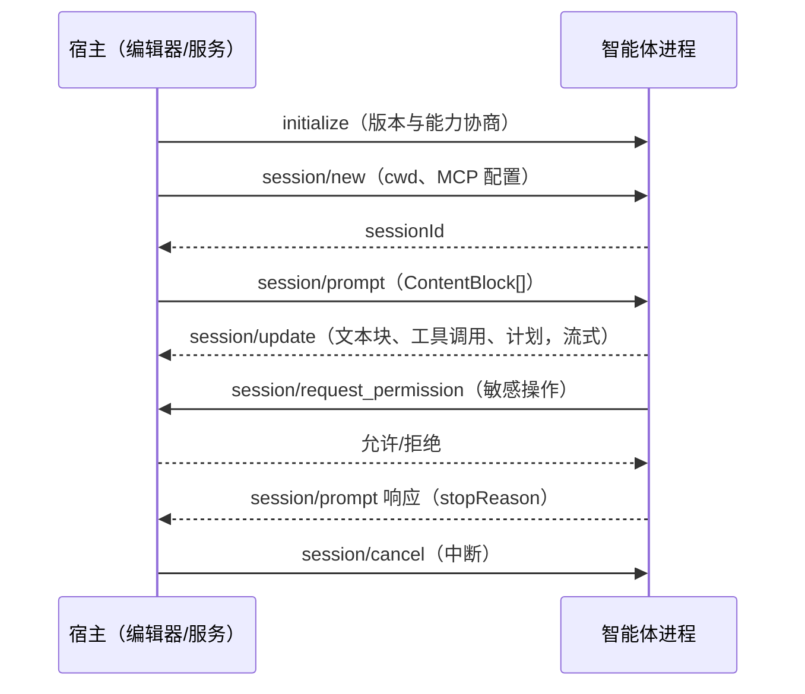

# Agent CLI 会话模式：发起、恢复与治理

开源生态里，命令行编码智能体（Claude Code、Codex CLI、Gemini CLI 等）提供同一组能力：
一次性发起任务、跨调用恢复会话、按标识治理运行中的会话。本文用开源产品举例说明这类
产品的会话使用方法，并给出与 agent_foundation 原语的对应关系。

## 一、三种会话形态

| 形态 | 代表 | 会话标识 | 恢复方式 |
|---|---|---|---|
| 一次性执行 | `claude -p`、`codex exec` | 结束后由 JSON 输出给出 session id | resume 子命令续用 |
| 交互式续聊 | `claude`、`codex`（TUI） | 本地会话文件 | `--continue` / resume 选择器 |
| 协议会话 | ACP（Zed 主导的开放标准） | `session/new` 返回 sessionId | `session/load` 重放历史 |

三种形态对应三种用法：脚本管道、人的日常对话、宿主程序（编辑器、后台服务）驱动。

## 二、一次性发起

把智能体当过滤器用：一次调用、一份输出、退出码表示成败。

```bash
claude -p "解释这段代码"              # Claude Code 非交互模式
codex exec "修复失败的测试"            # Codex CLI 非交互模式
git diff main | claude -p "列出这个 diff 里的真实缺陷"   # 管道输入
```

脚本化要点：

- 用 `--output-format json` 拿结构化结果。Claude Code 的 `.result` 字段是答案文本，
  `.session_id` 是会话标识。
- 用 `--output-format stream-json` 逐行消费 JSONL 事件流，适合长任务的实时展示。
- Codex 用 `--json` 输出事件流，`thread.started` 事件携带会话标识。
- 显式约束权限：Claude Code 的 `--allowedTools` 与 `--permission-mode dontAsk`，
  Codex 的 `--sandbox workspace-write`。

## 三、从输出中拿到会话标识

发起之后立即提取会话标识，后续所有恢复动作都依赖它：

```bash
# Claude Code：结果 JSON 自带 session_id
session_id=$(claude -p "审查这个代码库的性能问题" --output-format json | jq -r '.session_id')

# Codex：也可以不记 ID，用 --last 直接续最近一次
codex exec "审查这个代码库" --json
```

## 四、恢复会话

恢复是这类产品与普通聊天机器人的分界：历史上下文、计划、已批准的操作全部保留。

```bash
# Claude Code：按 ID 恢复，追加新指令
claude -p "接着聚焦数据库查询" --resume "$session_id"

# Claude Code：续当前目录最近一次会话
claude -p "继续" --continue

# Codex：按 ID 恢复非交互会话
codex exec resume "$session_id" "实施刚才的计划"

# Codex：续最近一次（--all 把检索范围扩大到所有目录）
codex exec resume --last "修复发现的问题"
```

分叉（fork）：在历史会话上开一条新分支尝试替代方案，原会话保持原样。
Claude Code 用 `--fork-session`，Codex 用 `codex fork`。

会话即文件：Codex 的 transcript 存于 `~/.codex/sessions/` 的 JSONL 文件。
transcript 可以直接归档、备份、审计。

## 五、协议层：ACP（Agent Client Protocol）

当宿主程序（编辑器、后台服务、聊天机器人）要驱动智能体时，逐产品写适配会变成
N×M 的重复劳动。ACP 是 Zed 主导的开放标准（Apache 2.0，JSON-RPC 2.0 over stdio，
NDJSON 分帧），把会话生命周期标准化：



- 发起：`initialize` 完成能力协商，`session/new` 创建会话并返回 `sessionId`。
- 恢复：智能体声明 `loadSession` 能力后，宿主用 `session/load` 重载历史，
  智能体把完整对话以 `session/update` 通知重放给宿主。
- 治理：`session/cancel` 中断当前回合；文件写入、命令执行等敏感操作经
  `session/request_permission` 交还宿主裁决；智能体经 `fs/*`、`terminal/*`
  反向调用宿主提供的能力。
- 生态：Zed 是参考实现的宿主，JetBrains、VS Code 扩展、Neovim 均已接入；
  Gemini CLI 是参考实现的智能体，Claude Code、Codex 等亦已支持。

## 六、两种治理模型的分界

- 聊天记录模型（Claude Code、Codex CLI）：会话是磁盘上的 transcript 文件，
  随时翻回去继续，恢复粒度是「这一次对话」。
- 进程治理模型（ACP、常驻服务）：会话是运行中的对象，有创建、加载、取消、关闭，
  恢复粒度是「这个正在运行的会话」。

两类模型可以组合：宿主程序用 ACP 驱动智能体进程，每个 ACP 会话底层仍是一份
可以 resume 的 transcript。

## 七、与 agent_foundation 原语的对应

agent_foundation 不包含任何具体产品的用法，它提供实现上述模式所需的底层构件：

| 产品层模式 | agent_foundation 原语 |
|---|---|
| 一次性发起、超时、心跳 | `ProcessSpec` / `ProcessSupervisor` |
| 会话标识持久化（把 sessionId 写入检查点） | `Checkpoint.continuation` / `FileCheckpointStore` |
| transcript 存储、脱敏、断行容错读取 | `TranscriptWriter` / `TranscriptReader` |
| JSONL/SSE 事件流清理 | `normalize_stream_line` / `decode_json_lines` |
| 调用失败的指数退避 | `retry` / `RetryPolicy` |

适配某个具体产品时：构造它的命令行，把它的输出解码成 `Event`，把它的会话标识
存入 `Checkpoint`。存活管理、恢复基础、记录与脱敏全部复用本包。

## 参考

- Claude Code headless 模式：https://code.claude.com/docs/en/headless
- Codex 开发者命令参考（`codex exec resume`、`--last`、`--all`、`codex fork`）：
  https://developers.openai.com/codex/developer-commands
- ACP 协议规范（Zed Industries，Apache 2.0）：https://agentclientprotocol.com/
